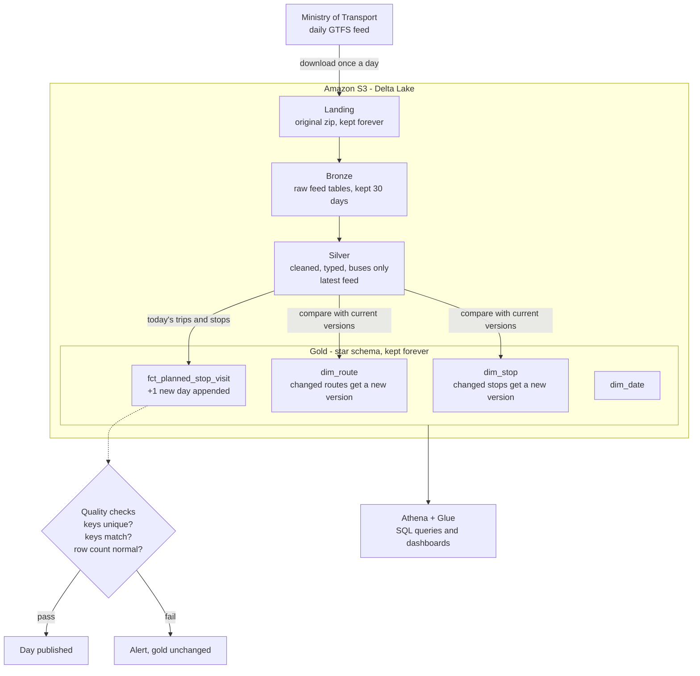

# Architecture: building the bus schedule history

## Goal

Answer, per day: **which bus lines most often never show up**, and **which bus lines are late the most**.

Both questions compare what the schedule promised with what actually happened. This document covers the first half: building a **history of the planned bus schedule**, one day at a time. The comparison with real-time data comes later.

## The core problem

The Ministry of Transport publishes a new GTFS feed every day. Each feed describes the schedule from **today onward** and forgets the past. If nobody saves today's schedule today, it is gone. Nobody can later ask "what was planned for line 337 on November 3rd?"

So the pipeline's main job is simple: **every day, capture that day's schedule and add it to a growing history**, without ever losing a day.

## Scope

- **Buses only.** Trains, light rail, cable cars, shared taxis and on-demand services are excluded.
- **Daily batch.** One run per day, early morning Israel time. No streaming.

## Architecture: a lakehouse on AWS

There is no database server. Data lives as files in **Amazon S3**, organised as **Delta Lake** tables. Delta adds what plain files lack: all-or-nothing writes, schema enforcement, merges and history. Storage and compute are separate.

| Part | Choice | Why |
|---|---|---|
| Storage | Amazon S3 (Tel Aviv region) | Cheap (a few dollars a month), durable, industry standard |
| Table format | Delta Lake on Parquet | Safe writes, `MERGE` for dimension history, column storage (one day of buses ≈ 23 MB) |
| Compute | A spare laptop at home running Airflow and Spark | Free. The data is small enough for one machine. The laptop keeps no state, so it can be replaced. |
| SQL access | AWS Athena + Glue Data Catalog | Serverless SQL over the Delta tables, pay per query (cents a month) |
| Orchestration | Apache Airflow | Schedules the daily run, retries, alerts |

## How the schedule history is built each day

### What "incremental" means for each table

| Table | Each day… | Over time |
|---|---|---|
| Landing zip | one new zip is added | a complete archive. Every other layer can be rebuilt from it. |
| Bronze | a new feed partition is added, partitions older than 30 days are removed | a short buffer for debugging |
| Silver | replaced by the newest feed | always "the current schedule" |
| `fct_planned_stop_visit` | **one new partition is appended** for today's service date (~4.4M bus stop visits on a weekday) | the full history of what was planned, one partition per day |
| `dim_route`, `dim_stop` | only **changes** are written: a route that changed operator, a stop that moved. The old version is closed and a new one opened. | a history of how the network changed. Each fact points to the version valid on its day. |
| `dim_date` | extended ahead as needed | calendar with Israeli holidays |

Re-running a day replaces exactly that day's partition, so runs are **safe to repeat**.

## Protecting the history

Because a missed day can never be recovered from the Ministry, the design leans heavily on safety:

- **Fallback feed.** Each feed covers weeks ahead, so if today's download fails, today is built from yesterday's feed. The fact table records which feed each day came from.
- **Quality gate.** Nothing reaches gold unless keys are unique, all keys match a dimension row, and the row count is normal for that weekday.
- **Alerts and a dead man's switch.** Failures send an alert. An external check also alerts if the pipeline *doesn't report in* by morning, which catches the laptop itself being off.
- **Nothing important lives on the laptop.** Data is in S3 with versioning on, code is in git. A dead laptop is a reinstall, not a data loss.
- **Cost guardrails.** An AWS budget alert, and a restricted access key that can only touch this project's bucket.

## Open questions

- **How to write the transformations:** PySpark (Python DataFrame code), Spark SQL (`.sql` files run by Spark), or dbt on Spark (SQL models with built-in data tests). Still to be decided.
- **Real-time source:** most likely a daily batch pull of archived real-time data (Hasadna's Open Bus project). Still to be verified.

See [`schema.md`](schema.md) for the vocabulary (line, route, trip, stop, station) and the full star schema.

## Current state

The repository still contains the first prototype: a daily Airflow DAG that loads the feed into Postgres and keeps one row per planned trip in `schedule.planned_trips`. It runs until the lakehouse version replaces it, so no days are lost in the meantime.
