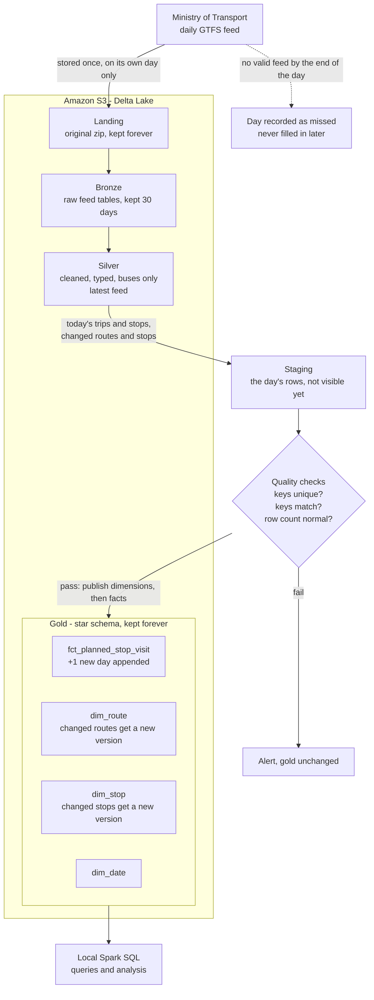
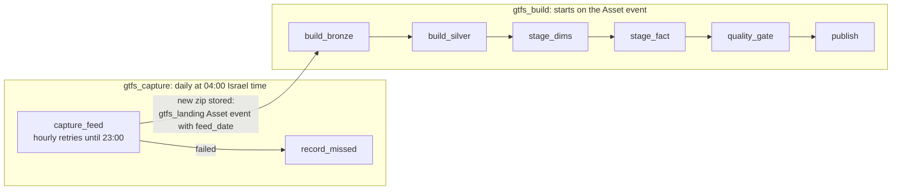

# Architecture: building the bus schedule history

## Goal

Answer, per day: **which bus lines most often never show up**, and **which bus lines are late the most**.

Both questions compare what the schedule promised with what actually happened. This document covers the first half: building a **history of the planned bus schedule**, one day at a time. The comparison with real-time data comes later.

## The core problem

The Ministry of Transport publishes a new GTFS feed every day. Each feed describes the schedule from **today onward** and forgets the past. If nobody saves today's schedule today, it is gone. Nobody can later ask "what was planned for line 337 on November 3rd?"

So the pipeline's main job is simple: **every day, capture that day's schedule and add it to a growing history**, without ever losing a day.

## Scope

- **Buses only.** Trains, light rail, cable cars, shared taxis and on-demand services are excluded.
- **Daily batch.** One run per day, early morning Israel time. No streaming.

## Architecture: a lakehouse on AWS

There is no database server. Data lives as files in **Amazon S3**, organised as **Delta Lake** tables. Delta adds what plain files lack: all-or-nothing writes, schema enforcement, merges and history. Storage and compute are separate.

| Part | Choice | Why |
|---|---|---|
| Storage | Amazon S3 (Tel Aviv region) | Cheap (a few dollars a month), durable, industry standard |
| Table format | Delta Lake on Parquet | Safe writes, `MERGE` for dimension history, column storage (one day of buses ≈ 23 MB) |
| Compute | Local only: a machine at home running Airflow and PySpark | Free, no paid cloud compute. The data is small enough for one machine. The machine keeps no state, so it can be replaced. |
| Transformations | PySpark | The data would fit lighter tools. Chosen on purpose, for the experience of building with Spark. |
| SQL access | Local Spark SQL for now | Free. Athena can be added later if the data on S3 grows too large to query locally. It would need the Glue Data Catalog only as a table list, not Glue jobs or crawlers. |
| Orchestration | Apache Airflow | Schedules the daily run, retries, alerts |

## How the schedule history is built each day

### What "incremental" means for each table

| Table | Each day… | Over time |
|---|---|---|
| Landing zip | one new zip is added and never replaced | a complete archive of every captured day |
| Bronze | a new feed partition is added, partitions older than 30 days are removed | a short buffer for debugging |
| Silver | replaced by the newest feed | always "the current schedule" |
| `fct_planned_stop_visit` | **one new partition is appended** for today's service date (~4.4M bus stop visits on a weekday) | the full history of what was planned, one partition per day |
| `dim_route`, `dim_stop` | only **changes** are written: a route that changed operator, a stop that moved. The old version is closed and a new one opened. | a history of how the network changed. Each fact points to the version valid on its day. |
| `dim_date` | extended ahead as needed | calendar with Israeli holidays |

### Missed days and reruns

- **A missed day stays missing.** It is skipped and recorded as missed, so the gap is never read as "no buses ran".
- **Never download a past day again.** The feed no longer contains it. The two feeds checked so far each cover 31 days from their own date, with nothing earlier.
- **Never build a day from another day's feed.** An older feed is a forecast, not that day's schedule. Trip counts for the same day differed by -8.8% to +15.1% between the Oct 9 and Nov 3 feeds.
- **Retrying the download on the same day is fine.** The zip is only stored once it passes validation, and an existing zip is never overwritten.

## Orchestration: two DAGs

Capture cannot be repeated once the day has passed, but the build is ordinary processing that can fail and be fixed. Keeping them apart means clearing a build can never reach the download.

`gtfs_capture` is plain Python. Each `gtfs_build` step will run as its own local `spark-submit`. `gtfs_build` is not built yet.

`gtfs_capture` uses `catchup=True`, but never to backfill: a run for a past day with no zip fails without downloading and records the day as missed. That way days when the machine was off are recorded too.

## Protecting the history

Because a missed day can never be recovered from the Ministry, the design leans heavily on safety:

- **Quality gate.** Nothing reaches gold unless keys are unique, all keys match a dimension row, and the row count is normal for that weekday.
- **Alerts and a dead man's switch.** Failures send an alert. An external check also alerts if the pipeline *doesn't report in* by morning, which catches the laptop itself being off.
- **Nothing important lives on the laptop.** Data is in S3 with versioning on, code is in git. A dead laptop is a reinstall, not a data loss.
- **Cost guardrails.** An AWS budget alert, and a restricted access key that can only touch this project's bucket.

## Open questions

- **Rebuilding from a stored zip:** whether a day may be rebuilt from its own captured zip, for example after a bug in the build. Still to be decided.
- **Real-time source:** most likely a daily batch pull of archived real-time data (Hasadna's Open Bus project). Still to be verified.

See [`schema.md`](schema.md) for the vocabulary (line, route, trip, stop, station) and the full star schema.

## Current state

The pipeline is not in operation yet, so no history is being collected. `gtfs_capture` is written and has only been tested against a fake S3 server. See [`stage-0-1.md`](stage-0-1.md) for the first build steps.
