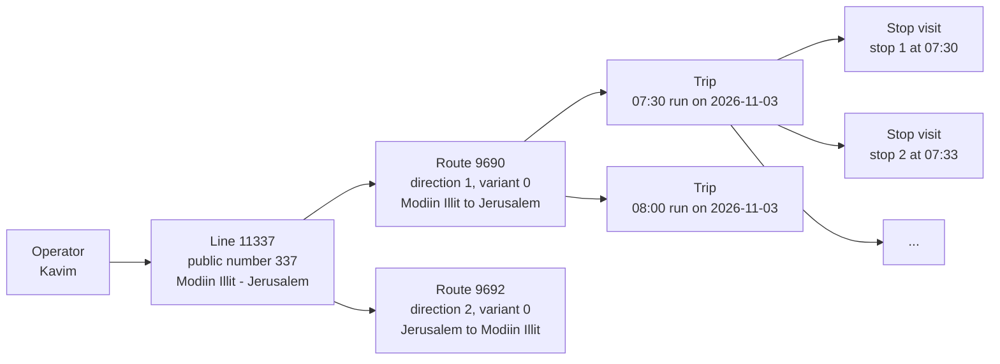
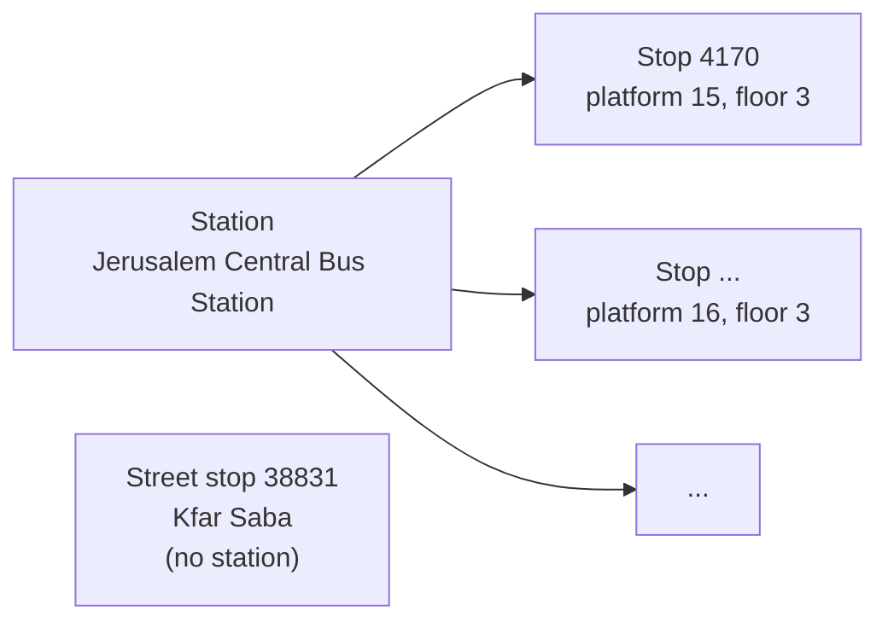
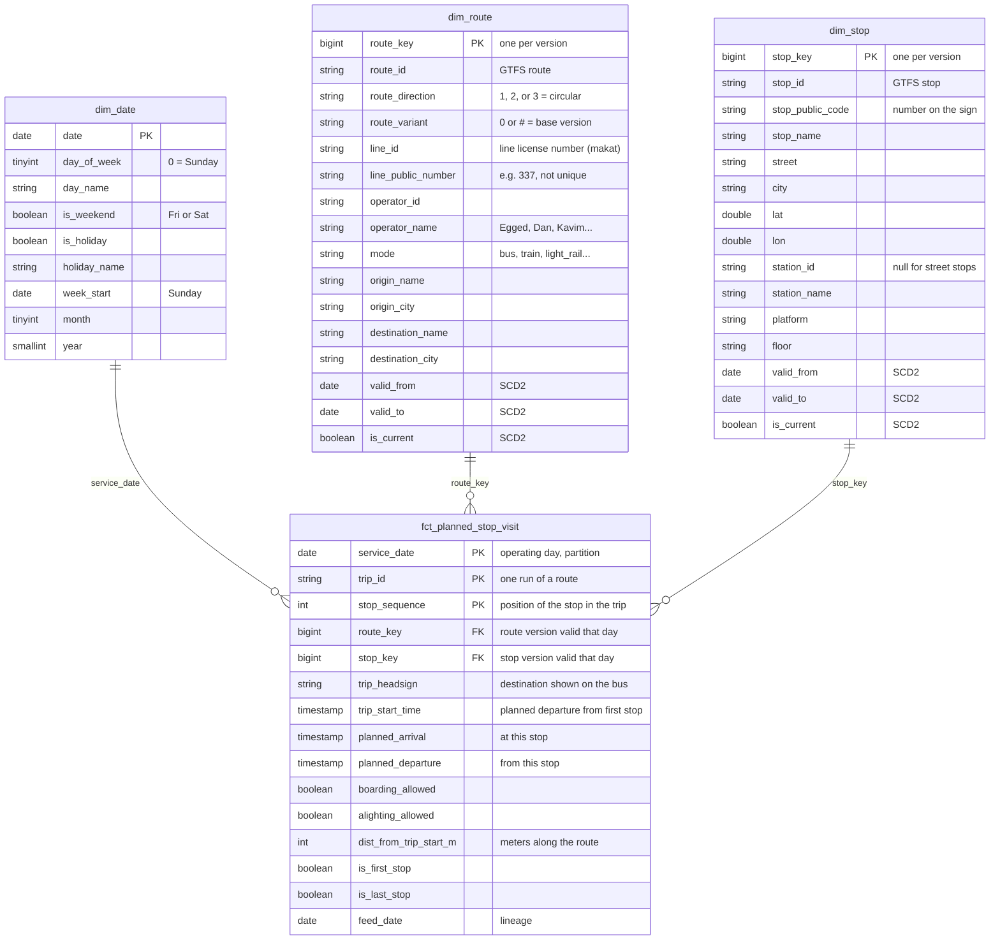

# Schema: gold layer star schema

The gold layer answers two questions per day: **which lines most often never show up**, and **which lines are late the most**. It is built daily from the Israel Ministry of Transport (MOT) GTFS feed and stored as Delta Lake (Parquet) tables, processed with PySpark.

An editable version of the diagram is in [`schema.dbml`](schema.dbml) (paste into [dbdiagram.io](https://dbdiagram.io)).

**Scope: buses only** (GTFS `route_type` 3). Trains, light rail, cable cars, shared taxis and on-demand services are excluded. The vocabulary below still describes them for completeness.

**Keys are not enforced by storage.** Delta Lake has no primary or foreign key constraints, so the `PK` / `FK` markings below document intent, and the pipeline's quality checks enforce them.

---

## 1. Vocabulary

Transit data mixes three vocabularies: GTFS terms (*agency*, *route*), Ministry of Transport terms (*makat*, *alternative*) and everyday words (*line*, *station*). This project uses **one name per concept**, defined here. All tables and docs use these names.

### What runs: operator → line → route → trip → stop visit

| Term | Definition | Example | Source in GTFS |
|---|---|---|---|
| **Operator** | A company running service under contract with the Ministry. | Kavim | `agency.txt` (GTFS calls it *agency*) |
| **Line** | A licensed transit service between two areas, in both directions and all its variants. Identified by the **line ID**: the Ministry's line license number (*makat*, מק״ט). | Line `11337`, public number 337, Modiin Illit ↔ Jerusalem | First part of `routes.route_desc` |
| **Line public number** | The number printed on the bus. **Not an identifier**: the same number is reused by unrelated lines in different regions. | "337" is both line `11337` (Kavim, Modiin Illit ↔ Jerusalem) and line `10337` (GB Tours, Bu'eine Nujeidat ↔ Haifa) | `routes.route_short_name` |
| **Route** | **One direction of one variant of a line**: a fixed, ordered list of stops. Every trip on a route visits the same stops in the same order. | Route `9690`: line 11337, direction 1, variant 0, Modiin Illit → Jerusalem | `routes.txt`, one row per route (`route_id`) |
| **Route direction** | Which way the route runs along its line: `1` and `2` are the two opposite directions, `3` means a circular route that ends where it starts. | Route `9690` is direction 1, route `9692` is direction 2 | Second part of `route_desc` |
| **Route variant** | A version of the line that differs in its stops: a short-turn, a detour through another neighbourhood, an extension at certain hours. `0` or `#` is the base version. *(The Ministry calls it "alternative".)* | Jerusalem light rail line `73001`: variant 0 runs the full line, variant 4 starts mid-line at Givat HaMivtar | Third part of `route_desc` |
| **Trip** | One run of a vehicle along a route, at a specific time, on a specific day. | The 07:30 departure of route 9690 on 2026-11-03 | `trips.txt` (`trip_id`) |
| **Stop visit** | One trip at one of its stops: the trip's planned arrival at that stop. **This is the grain of the fact table.** | Trip of 07:30, 7th stop, planned 07:52 | `stop_times.txt` |

**How many?** Today's feed has 36 operators, about 7,800 routes and 310,000 trips (123,000 of them on a weekday). Each trip visits 38 stops on average.

**Trains are an exception.** Israel Railways routes don't follow the line ID / direction / variant scheme (`route_desc` holds a single number and there is no public number), so for trains those columns are empty and the route is the smallest unit.

### Where it stops: station → stop

| Term | Definition | Example | Source in GTFS |
|---|---|---|---|
| **Stop** | A physical point where vehicles stop and passengers board: a pole, a shelter, or a platform. **Every stop visit happens at a stop.** | Stop `38831`: "Bar Lev school / Ben Yehuda", Kfar Saba | `stops.txt` rows with `location_type = 0` |
| **Stop ID** | Internal GTFS identifier of a stop. Stable across daily feeds. | `1` | `stops.stop_id` |
| **Stop public code** | The number printed on the stop sign, which riders type into apps. Also stable. | `38831` | `stops.stop_code` |
| **Station** | A complex that groups several stops under one name: a central bus station, a train station, a terminal. **Vehicles never stop at a station itself, only at the stops (platforms) inside it.** Most street stops belong to no station. | Jerusalem Central Bus Station contains, among others, stop `4170` (platform 15, floor 3) | `stops.txt` rows with `location_type = 1`, linked through `parent_station` |

Today's feed: 35,164 stops, of which 1,088 are inside one of 238 stations.

### Time

| Term | Definition |
|---|---|
| **Service date** | The operating day a trip belongs to. GTFS times count from the start of that day and can go past 24:00: a trip at `25:30:00` on service date Nov 3 actually runs at 01:30 on Nov 4. |
| **Feed date** | The day a GTFS feed was published. Each feed covers roughly the next 30–60 service dates. This pipeline builds service date *D* from the feed of day *D*. |

### Naming rules

- `*_id`: a stable identifier (`line_id`, `route_id`, `stop_id`, `station_id`, `operator_id`, `trip_id`).
- `*_public_*`: what riders see. Useful for display, **never unique** (`line_public_number`, `stop_public_code`).
- `*_key`: a surrogate key in the warehouse that points to one *version* of a dimension row (see SCD2 below).

---

## 2. Star schema

Planned for the real-time phase (not built yet): `fct_observed_stop_visit` (stop visits inferred from SIRI GPS data) and `fct_stop_visit_performance` (planned joined to observed, with `delay_seconds` and a `status` of on_time / late / skipped / trip_not_run).

---

## 3. Table reference

### `fct_planned_stop_visit`: what the schedule promised

**One row = one stop visit: one trip at one of its stops, on one service date.**
For example: *"On 2026-11-03, the 07:30 trip of route 9690 is planned to reach stop 12345, its 7th stop, at 07:52."*

- **Natural key:** `(service_date, trip_id, stop_sequence)`
- **Size:** about 4.7M rows on a weekday, 2.4M on Friday, 0.8M on Saturday
- **Partitioning:** by `service_date`, so a daily rerun overwrites exactly one partition

| Column | Meaning |
|---|---|
| `service_date` | Operating day (Israel local). |
| `trip_id` | The trip. Changes with every feed, so it identifies a trip only within one service date. Kept on the fact as a *degenerate dimension*: an identifier with no dimension table of its own. |
| `stop_sequence` | Position of the stop within the trip (1, 2, 3…). Needed because a circular route can visit the same stop twice. |
| `route_key` | The route this trip runs, pointing to the `dim_route` version valid on `service_date`. |
| `stop_key` | The stop, pointing to the `dim_stop` version valid on `service_date`. |
| `trip_headsign` | Destination text on the vehicle's sign. |
| `trip_start_time` | Planned departure from the trip's first stop. **Together with `route_id`, this is how real-time data is matched to planned trips.** |
| `planned_arrival` / `planned_departure` | Planned times at this stop, converted from GTFS `HH:MM:SS` offsets to real timestamps. |
| `boarding_allowed` / `alighting_allowed` | Whether passengers may get on / off here. The last stop of a trip allows no boarding, so a bus not stopping there isn't a "skip". |
| `dist_from_trip_start_m` | Meters along the route from the first stop. Helps match GPS points to stops. |
| `is_first_stop` / `is_last_stop` | Convenience flags. |
| `feed_date` | Which daily feed produced the row. |

### `dim_route`: what runs

**One row = one version of one route** (one direction of one variant of a line). The route's line and operator are stored on the same row, so you can group by `route_id` (one direction), by `line_id` (the whole line) or by `operator_name` without extra joins.

| Column | Meaning |
|---|---|
| `route_key` | Surrogate key, one per version of the route. |
| `route_id` | GTFS route ID. Stable across feeds. |
| `route_direction` | `1` / `2` = the two directions of the line, `3` = circular. |
| `route_variant` | Which version of the line: `0` or `#` = base, other values = short-turns, detours, extensions. |
| `line_id` | Line license number (*makat*). **Group by this to analyse a line.** Empty for trains. |
| `line_public_number` | Number on the bus. Display only: not unique across the country. |
| `operator_id`, `operator_name` | Operator currently running the route. |
| `mode` | `bus`, `train`, `light_rail`, `cable_car`, `shared_taxi`, `on_demand`. |
| `origin_name`, `origin_city`, `destination_name`, `destination_city` | First and last stop of the route, parsed from GTFS `route_long_name`. |
| `valid_from`, `valid_to`, `is_current` | SCD2 bookkeeping (see below). |

### `dim_stop`: where vehicles stop

**One row = one version of one stop.** Stations are not rows here: a stop inside a station carries the station's ID and name as attributes.

| Column | Meaning |
|---|---|
| `stop_key` | Surrogate key, one per version of the stop. |
| `stop_id` | GTFS stop ID. Stable across feeds. |
| `stop_public_code` | Number on the stop sign. |
| `stop_name` | Usually "street / cross-street". |
| `street`, `city` | Parsed from GTFS `stop_desc`. |
| `lat`, `lon` | Location. Used later to check whether a GPS trace passed the stop. |
| `station_id`, `station_name` | The station this stop is part of. Empty for street stops. |
| `platform`, `floor` | Position inside the station, parsed from `stop_desc`. |
| `valid_from`, `valid_to`, `is_current` | SCD2 bookkeeping (see below). |

### `dim_date`: calendar context

**One row = one calendar day.** Holds `day_of_week` (0 = Sunday), `is_weekend` (Friday/Saturday), `is_holiday` and `holiday_name`, `week_start`, `month` and `year`, so queries like "Sundays only" or "excluding holidays" need no date arithmetic.

---

## 4. Design decisions

- **Star, not a normalized store.** Analysts query one fact table and a few small dimensions with simple joins. Column storage (Parquet) compresses the repeated values, which makes the denormalized fact affordable.
- **Line attributes live on `dim_route` (no `dim_line`).** A separate line table would turn the star into a snowflake for only three columns. Grouping by `line_id` gives the line-level view.
- **Stations are attributes, not rows.** Vehicles only stop at stops, so the fact only ever references stops. Station membership is a property of a stop.
- **Planned facts are immutable.** Real-time observations go into a separate fact table instead of updating planned rows. Reruns are idempotent, and the plan is never changed after the fact.
- **SCD type 2 dimensions.** When a route changes operator or a stop moves, the old version is closed (`valid_to`) and a new one added (51 stops moved within 25 days). Each fact points to the version valid on its service date, so past days are analysed as they really were.
- **Partition by `service_date`.** Each daily run writes exactly one partition, and queries filtered by date read only what they need.

## Appendix: mapping to the raw GTFS fields

| Warehouse column | GTFS source |
|---|---|
| `operator_id`, `operator_name` | `agency.agency_id`, `agency.agency_name` |
| `line_id`, `route_direction`, `route_variant` | `routes.route_desc` split on `-` (e.g. `11337-1-0`) |
| `line_public_number` | `routes.route_short_name` |
| `origin_*`, `destination_*` | `routes.route_long_name` (`origin-city<->destination-city-<dir><variant>`) |
| `mode` | `routes.route_type`: 3 bus, 2 train, 0 light rail, 5 Carmelit / cable car, 8 shared taxi, 715 on-demand |
| `stop_public_code` | `stops.stop_code` |
| `street`, `city`, `platform`, `floor` | `stops.stop_desc` (`רחוב: … עיר: … רציף: … קומה: …`) |
| `station_id` | `stops.parent_station` |
| `boarding_allowed` / `alighting_allowed` | `stop_times.pickup_type = 0` / `stop_times.drop_off_type = 0` |
| `dist_from_trip_start_m` | `stop_times.shape_dist_traveled` |
